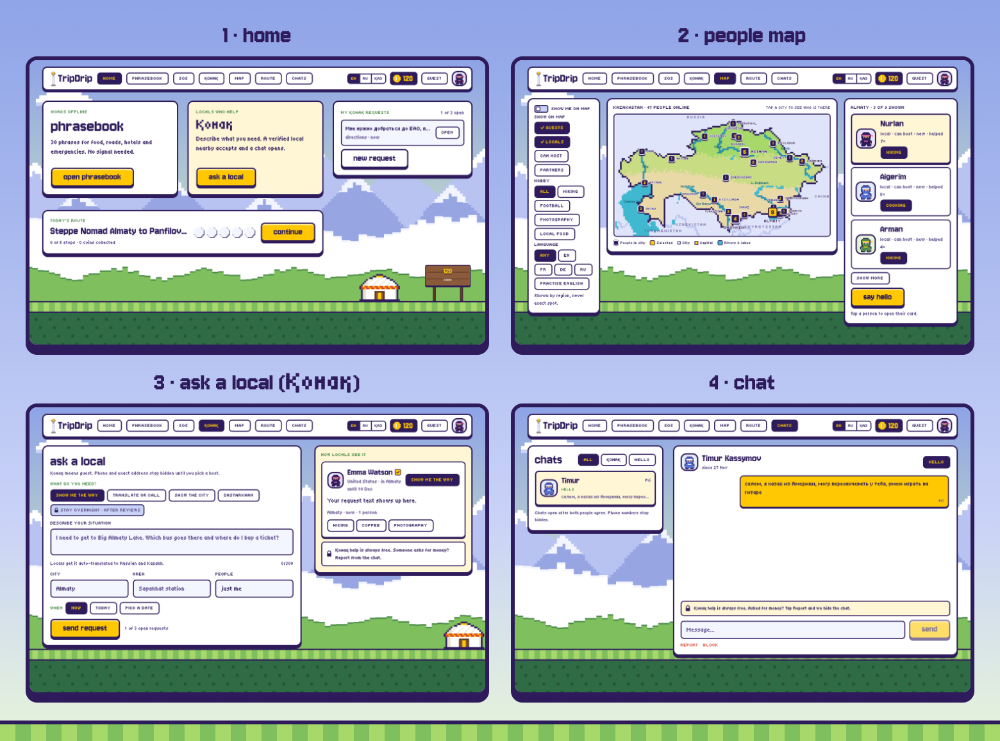
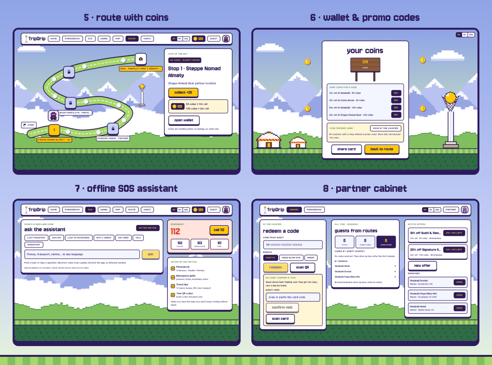
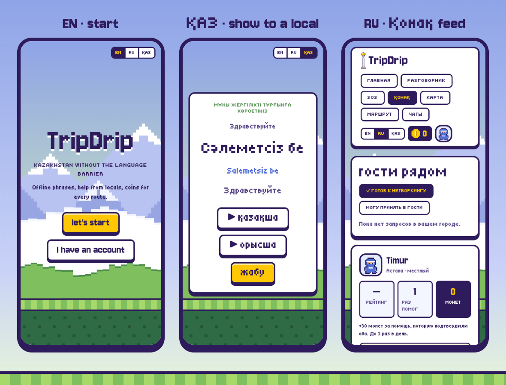
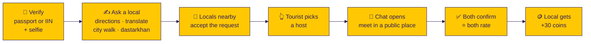
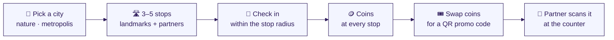
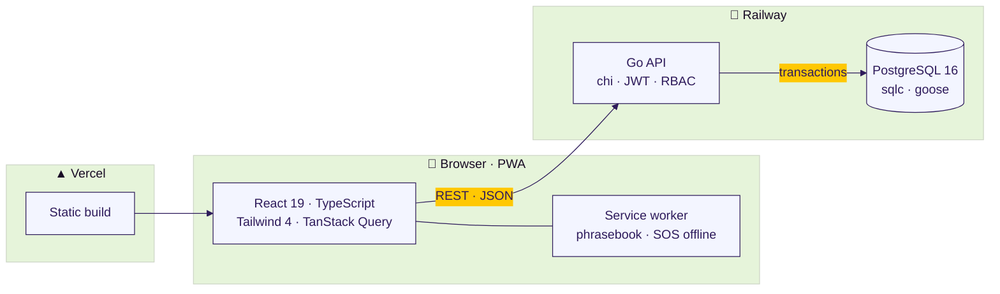

<div align="center">


# TripDrip — Kazakhstan without the language barrier

**Offline SOS phrases · help from verified locals · coins for every route.**

<p align="center">
  <a href="https://tripdrip.macintsh.tech"></a>
  
  <a href="https://github.com/astmirzhan/TripDrip/actions/workflows/ci.yml"></a>
</p>

<p align="center">
  
  
  
  
  
  
</p>

</div>

---

## 🎬 Demo video

A one-minute walk through the live app: the people map, asking a local, chat, the phrasebook and the offline SOS assistant.


https://github.com/user-attachments/assets/a0cb4e92-c1e2-441f-b583-b8dcb349afaa


## 🏔️ What it is

A tourist in Kazakhstan often doesn't speak Kazakh or Russian, doesn't know which bus to take, and has no idea what to
do after losing a passport in the mountains. TripDrip connects them with **verified locals** and **local businesses**,
and keeps the most important help working **without internet**.

| | |
| --- | --- |
| **Who it's for** | Foreign tourists in Kazakhstan, and the locals who want to help them |
| **What they get** | A local who shows the way, a phrasebook that talks, an SOS guide in airplane mode, routes with coins |
| **What locals get** | Coins, rating and real guests, for free help only |
| **What partners get** | Tourists brought by routes, QR promo codes, stats by guest country |

## 📱 The app




<p align="center">
  
</p>

## 🤝 How Қонақ works

**Қонақ** means *guest* in Kazakh. A tourist asks, a local nearby answers, and nobody's phone number is shown.



- **Help is always free.** Messages that look like a price or an ad are flagged in the chat, and *Report* hides the chat.
- **City only, never an exact spot.** The map shows people by city or district.
- **Up to 3 open requests per tourist, up to 3 paid helps per local per day**, so nobody farms coins.
- **Stay overnight** unlocks only after a local has reviews.

## 🆘 Works without internet

TripDrip is an installable **PWA**. The service worker saves the whole app on the first visit, so these keep working in
airplane mode:

- **Phrasebook:** 30 Kazakh phrases with transcription and the Russian line, a *Show to a local* full-screen mode, and
  audio in Kazakh and Russian.
- **SOS assistant:** 13 topics (lost passport, injury, lost in the mountains, ATM and cards, currency exchange, SIM card,
  taxi, transport, visa, earthquake, police, food, help from a local) answered step by step in **English, Russian and Kazakh**, plus one-tap calls to
  **112 · 102 · 103 · 101**.
- **Your QR codes:** promo codes and the guest card.

## 🗺️ Routes and coins



| Coins | You get |
| --- | --- |
| 50 | 10% off at a partner |
| 100 | 20% off at a partner |
| +20 | for a visit confirmed by the guest card, once a day per brand |

Coins are loyalty points: they can't be bought or cashed out. Check-ins are checked against the stop radius and travel
speed, and every promo code works once.

## 🧪 Try it in 2 minutes

1. Open **https://tripdrip.macintsh.tech** and switch the language: **EN · RU · ҚАЗ**.
2. Sign in as the tourist `emma.us@demo.tripdrip` (password `TripDrip2026!`).
3. Open **Map** → pick a city → open a person → *say hello*. Then **Қонақ** → describe what you need → *send request*.
4. Turn on airplane mode and open **SOS** and **Phrasebook**: they still work.
5. Sign in as the local `timur.kz@demo.tripdrip` to answer, or as the partner `okadzaki@demo.tripdrip` to redeem codes.

The demo world has **47 people in 24 cities** of Kazakhstan, partner cafés and shops, and offers, so the map is alive from
the first minute.

## 🏗️ How it's built



- **Backend:** Go with a layered design (handlers → services → sqlc queries), every money-like change (coins, promo
  codes, check-ins) in one database transaction. API described in [`docs/openapi.yaml`](docs/openapi.yaml).
- **Privacy:** exact GPS of people is never stored; the map uses city and district centroids. Document photos are
  dropped after the verification decision.
- **Frontend:** pixel-art design moved from Figma one to one ([`docs/design.md`](docs/design.md)), a pixel map of
  Kazakhstan generated from Natural Earth data, and a dictionary-based i18n for EN / RU / ҚАЗ.

## ✅ Quality

| Check | What it covers |
| --- | --- |
| `go test ./...` | domain rules (coins, geo, check-in anti-fraud) and end-to-end HTTP flows |
| `npx tsc -b` | strict TypeScript across the frontend |
| `npm run lint` | oxlint, zero warnings |
| `npm run build` | production build and the offline precache list |

## 🛠️ Run it locally

```bash
# 1. Backend + database
docker compose up -d --build          # API on http://localhost:8080
curl http://localhost:8080/healthz

# 2. Frontend
cd frontend
cp .env.example .env                  # VITE_API_URL=http://localhost:8080/api/v1
npm install
npm run dev                           # http://localhost:5173
```

Set `RUN_SEED=true` to load the demo world and `AUTO_APPROVE_VERIFICATION=true` to skip the moderator in a demo.

More detail: [`docs/BACKEND.md`](docs/BACKEND.md) (architecture, rules, REST API, env vars) ·
[`docs/design.md`](docs/design.md) (design system) · [`idea.md`](idea.md) (product spec).

## 👥 Team

| | Role |
| --- | --- |
| **[astmirzhan](https://github.com/astmirzhan)** | frontend, deployment |
| **[birxnm](https://github.com/birxnm)** | design in Figma |
| **[xJam-byte](https://github.com/xJam-byte)** | backend |

<div align="center">

**TripDrip** · made for Órleu Hack 2026 · Ninja Turtles 🐢

</div>
