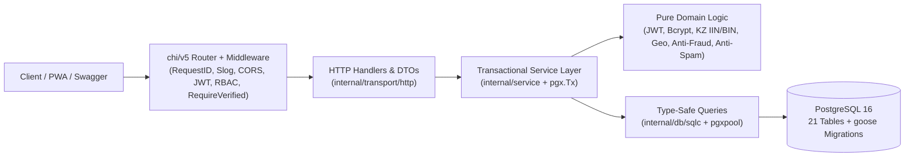

# TripDrip

<p align="center">
  <strong>Travel PWA Platform & Backend API for Kazakhstan</strong><br/>
  Gamified routes, <strong>Қонақ (Qonaq)</strong> local-to-tourist mutual help, privacy-first networking map, loyalty coin economy, and partner QR checkout cabinet.
</p>

<p align="center">
  
  
  
  
  
  
  
</p>

---

## Table of Contents

- [Overview](#overview)
- [Architecture](#architecture)
- [Core Modules & Business Rules](#core-modules--business-rules)
- [Project Structure](#project-structure)
- [Quick Start](#quick-start)
  - [Option 1: Docker Compose (Recommended)](#option-1-docker-compose-recommended)
  - [Option 2: Local Development (Go + PostgreSQL 16)](#option-2-local-development-go--postgresql-16)
- [Environment Variables](#environment-variables)
- [REST API Reference](#rest-api-reference)
- [Database & Code Generation](#database--code-generation)
- [Testing](#testing)
- [Seed Data & Demo Accounts](#seed-data--demo-accounts)
- [Security & Privacy Guarantees](#security--privacy-guarantees)

---

## Overview

**TripDrip** is a travel ecosystem tailored for Kazakhstan (`Almaty`, `Astana`, `Shymkent`, `Turkestan`, `Kolsay`, `Charyn`, `Burabay`, and major regional centers). It connects international tourists with verified local residents and local businesses through four pillars:

1. **Қонақ (Qonaq) Mutual Help** — Tourists create help requests (`directions`, `translation_call`, `city_tour`, `dastarkhan`, `host_stay`), verified locals accept/decline from a city feed or direct map request, and mutual completion rewards locals with loyalty coins and reputation ratings.
2. **Privacy-First People & Partner Map** — Verified users can opt in (`is_visible = false` by default) to appear on the map using **city/district centroids only**—exact GPS coordinates of users are never stored or returned.
3. **Gamified Route Generator & Anti-Fraud Check-ins** — Generates dynamic `A → B` routes of 3–5 stops combining Kazakhstan landmarks and partner branches, distributing tourist traffic and validating check-ins with Haversine radius checks and travel-speed anomaly detection.
4. **Coin Economy & Partner Cabinet** — Users earn non-monetary loyalty coins for check-ins, completed routes, and Qonaq help, then exchange them for single-use QR promo codes redeemed at partner branches (e.g., *Okadzaki*, *Coffee Boom*, *Steppe Nomad Gear*).

> Full product & architecture specification: [`idea.md`](./idea.md)  
> OpenAPI 3.0.3 specification: [`docs/openapi.yaml`](./docs/openapi.yaml)

---

## Architecture

The backend follows a clean layered architecture in Go with explicit PostgreSQL transaction boundaries (`pgx.Tx`) and compile-time type-safe SQL via `sqlc`:



### Tech Stack

| Layer | Technology |
|---|---|
| **Language** | Go `1.24` |
| **HTTP Router & Middleware** | `github.com/go-chi/chi/v5` (`v5.5.0`) + structured JSON logging (`log/slog`) |
| **Database** | PostgreSQL `16` (`pgcrypto`, GIN indexes, partial indexes, CHECK constraints) |
| **DB Driver & Pool** | `github.com/jackc/pgx/v5` (`v5.7.2`) |
| **SQL Codegen** | `sqlc` (`pgx/v5` driver, interfaces & JSON tags enabled) |
| **Schema Migrations** | `github.com/pressly/goose/v3` (`v3.24.1`, embedded SQL migrations) |
| **Auth & Security** | `github.com/golang-jwt/jwt/v5` (Access + Refresh JWT), `golang.org/x/crypto/bcrypt`, SHA-256 document hashing |
| **Containerization** | Multi-stage `Dockerfile` (`golang:1.24-alpine` → `alpine:3.20`) + `docker-compose.yml` |

---

## Core Modules & Business Rules

### 1. Auth, Roles & KYC Verification
- **Automatic Role Assignment on Registration**:
  - `country_code != "KZ"` → `tourist`
  - `country_code == "KZ"` → `local`
  - Explicit `"partner"` option → `partner` (requires 12-digit KZ BIN verification and admin approval before going live)
- **Strict Verification Gate (`RequireVerified`)**: Unverified users (`is_verified = false`) receive `403` on protected social, map, route, and wallet endpoints until KYC is approved.
- **Document Security**:
  - Local IIN and partner BIN values undergo official **Kazakhstan 12-digit modulo-11 checksum validation**.
  - Only `SHA-256` `doc_number_hash` is persisted in `verifications`.
  - When an admin approves or rejects a verification, `doc_photo_url` and `selfie_url` are **automatically cleared to `NULL`**.
- **Account Deletion**: `DELETE /api/v1/me` performs soft deletion and cascades cleanup across profiles, verification docs, and map presence.

### 2. Privacy-First Map & Networking
- `map_presence` stores **only precomputed Kazakhstan city/district centroids** (`internal/domain/geo.go` supporting Almaty, Astana, Shymkent districts and major cities in both Latin and Cyrillic aliases).
- Map visibility defaults to `false` and automatically hides tourists once `trip_end_date` expires.
- Layers supported: `tourists`, `locals_networking`, `locals_hosting`, `partners`, with filters by `city`, `hobby`, `language`, `vibe`, and `country`.
- Direct networking requests create a chat (`context_type = 'networking'`) only upon explicit recipient acceptance.

### 3. Қонақ (Qonaq) & Unified Chat System
- **Active Request Cap**: Tourists may have at most **3 active Qonaq requests** simultaneously.
- **Two Entry Paths**:
  - **Public Feed**: Locals in the same city view open requests and accept/decline (`decline` hides only for that local). Tourist selects one host to open a `qonaq` chat.
  - **Direct Map Request**: Tourist targets a specific local directly from the map.
- **Mutual Completion & Rewards**: Both tourist and local confirm completion (`POST /qonaq/requests/{id}/confirm`). Mutual confirmation awards **+30 coins** to the local (capped at **3 rewarded completions per day**) and unlocks 1–5 star reviews with automatic profile rating recalculation.
- **Anti-Spam Scanner**: All chat messages pass through `domain.IsCommercialSpam` (detects currency amounts like `тг/kzt/$/usd/₽`, URLs/Telegram/WhatsApp links, KZ phone numbers, and solicitation keywords such as `"каспи"`, `"предоплата"`, `"платная экскурсия"`). Flagged messages are marked (`is_flagged_spam`) for moderation.

### 4. Gamified Route Generation & Anti-Fraud
- `POST /api/v1/routes/generate` constructs personalized `A → B` routes containing **3–5 stops** matching user `vibe_preference` (`nature`, `megapolis`, `both`) using `DistanceToSegmentMeters`, boosted partner weighting (`is_boosted`), load distribution, and **at most 1 branch per partner brand** per route (preventing duplicate daily partner check-ins).
- **Check-in Anti-Fraud (`POST /routes/{id}/stops/{pointId}/checkin`)**:
  - **Radius Check**: Haversine distance between user GPS and stop coordinates must be within `radius_meters` (default `100m` for partners, `150m` for landmarks).
  - **Speed Anomaly Check**: Consecutive check-ins exceeding **`180 km/h`** (`ValidateTravelSpeed`) are rejected to block GPS spoofing.
  - **Rewards**:
    - Landmark check-in: **+10 coins** (once per landmark lifetime)
    - Partner visit (checkout confirmed): **+20 coins** (once per brand per day)
    - Full route completion bonus: **+30 coins**

### 5. Wallet, Promo Codes & Partner Cabinet
- All coin updates run inside ACID transactions with `idempotency_key` protection and ledger entries (`coin_transactions`).
- Exchanging coins (`POST /offers/{id}/exchange`) atomically checks offer limits, deducts coins, and issues a single-use QR promo code (`PROMO-...`).
- Partners redeem QR codes (`POST /partner/promocodes/redeem`) atomically (preventing double redemption with `409 Conflict`), confirm physical visits (`POST /partner/visits/confirm`), and view branch + guest-country analytics (`GET /partner/stats`).

### 6. Safety & Moderation
- **Blocking**: Blocked users cannot send networking/chat/Qonaq interactions and are hidden from each other.
- **Auto-Hide on 3 Reports**: Receiving **3 unique open reports** automatically sets `hidden_by_moderation = true` on `map_presence`.
- **Admin Queues**: Dedicated endpoints for reviewing pending KYC verifications, resolving/dismissing reports (with optional user ban), and approving partner brands.

---

## Project Structure

```text
tripdrip/
├── backend/
│   ├── cmd/api/
│   │   └── main.go                       # Entrypoint, migrations, optional seeding, DI, graceful shutdown
│   ├── internal/
│   │   ├── config/
│   │   │   └── config.go                 # Environment variable loader & validation
│   │   ├── db/
│   │   │   ├── migrate.go                # Embedded goose migration runner
│   │   │   ├── migrations/
│   │   │   │   └── 001_init.sql          # Full PostgreSQL 16 schema (21 tables, ENUMs, indexes)
│   │   │   ├── queries/                  # Raw SQL queries for sqlc (10 domain query files)
│   │   │   └── sqlc/                     # Generated type-safe Go data access layer
│   │   ├── domain/
│   │   │   ├── antifraud.go              # GPS radius & 180 km/h travel speed anomaly checks
│   │   │   ├── crypto.go                 # bcrypt password hashing, SHA-256 doc hash, promo codes
│   │   │   ├── domain_test.go            # Unit tests for IIN/BIN, geo, anti-fraud, spam scanner
│   │   │   ├── errors.go                 # Typed domain errors mapped to HTTP statuses
│   │   │   ├── geo.go                    # KZ city/district centroids, Haversine & segment math
│   │   │   ├── jwt.go                    # Access & Refresh JWT generation and verification
│   │   │   ├── spam.go                   # Commercial solicitation & link regex scanner
│   │   │   └── validators.go             # KZ 12-digit IIN/BIN mod-11, ISO country, email/phone
│   │   ├── seed/
│   │   │   └── seed.go                   # Idempotent demo seeder (admins, tourists, locals, partners, landmarks)
│   │   ├── service/                      # Business logic & pgx.Tx transactions (11 service files)
│   │   └── transport/http/
│   │       ├── dto/dto.go                # Request/Response payloads
│   │       ├── e2e_test.go               # Full end-to-end integration test suite
│   │       ├── handlers_auth.go          # Auth, /me, KYC verification handlers
│   │       ├── handlers_partner_admin.go # Partner cabinet & Admin moderation handlers
│   │       ├── handlers_routes_wallet.go # Routes, check-ins, wallet, offers, promos handlers
│   │       ├── handlers_social.go        # Map, networking, Qonaq, chats, safety handlers
│   │       ├── middleware.go             # CORS, slog request logger, JWT auth, RBAC, RequireVerified
│   │       ├── response.go               # Unified JSON success & error envelope
│   │       └── router.go                 # chi/v5 route table
│   ├── .env.example
│   ├── Dockerfile
│   ├── Makefile
│   ├── go.mod
│   ├── go.sum
│   └── sqlc.yaml
├── docs/
│   └── openapi.yaml                      # OpenAPI 3.0.3 API specification
├── docker-compose.yml                    # PostgreSQL 16 + Backend container stack
├── idea.md                               # Master product & architecture specification
├── .gitignore
└── README.md
```

---

## Quick Start

### Option 1: Docker Compose (Recommended)

Requires [Docker](https://www.docker.com/) and Docker Compose.

```bash
# Start PostgreSQL 16 + build and run the Go API server
docker compose up --build

# Or start with demo data seeded automatically (PowerShell):
$env:RUN_SEED="true"; docker compose up --build

# Bash / Linux / macOS:
RUN_SEED=true docker compose up --build
```

The API will be available at **`http://localhost:8080`** and healthcheck at **`http://localhost:8080/healthz`**.

---

### Option 2: Local Development (Go + PostgreSQL 16)

1. **Create a PostgreSQL database** (e.g., `tripdrip`) and configure `backend/.env` from the template:
   ```bash
   cp backend/.env.example backend/.env
   ```
   Edit `backend/.env` with your local `DATABASE_URL` and `JWT_SECRET`.

2. **Run migrations, seed demo data, and start the server**:
   ```powershell
   # PowerShell example
   cd backend
   $env:DATABASE_URL="postgres://postgres@localhost:5432/tripdrip?sslmode=disable"
   $env:JWT_SECRET="dev-super-secret-change-in-production-32chars"
   $env:AUTO_MIGRATE="true"
   $env:RUN_SEED="true"
   go run ./cmd/api
   ```

   ```bash
   # Bash example
   cd backend
   export DATABASE_URL="postgres://postgres@localhost:5432/tripdrip?sslmode=disable"
   export JWT_SECRET="dev-super-secret-change-in-production-32chars"
   export AUTO_MIGRATE=true
   export RUN_SEED=true
   go run ./cmd/api
   ```

3. **Run migrations + seed only (without starting HTTP server)**:
   ```bash
   cd backend
   go run ./cmd/api --seed-only
   ```

### Useful `Makefile` Targets (inside `backend/`)

| Command | Description |
|---|---|
| `make build` | Compile binary to `backend/bin/tripdrip-api.exe` |
| `make run` | Run API server locally |
| `make test` | Run all unit and integration tests (`go test -v ./...`) |
| `make sqlc-generate` | Regenerate Go queries from `internal/db/queries/*.sql` |
| `make migrate-up` | Apply migrations via standalone `goose` CLI |
| `make migrate-down` | Rollback migrations via standalone `goose` CLI |
| `make seed` | Apply migrations and populate demo seed data (`--seed-only`) |

---

## Environment Variables

| Variable | Required | Default | Description |
|---|---|---|---|
| `SERVER_PORT` | No | `8080` | HTTP server listening port |
| `DATABASE_URL` | **Yes** | — | PostgreSQL connection string (DSN) |
| `JWT_SECRET` | **Yes** | — | Signing secret for Access & Refresh JWTs (min 16 characters) |
| `JWT_ACCESS_TTL` | No | `15m` | Access token lifetime (`time.ParseDuration` format) |
| `JWT_REFRESH_TTL` | No | `168h` | Refresh token lifetime (default 7 days) |
| `CORS_ORIGINS` | No | `*` | Comma-separated allowed CORS origins |
| `AUTO_MIGRATE` | No | `true` | Automatically execute `goose up` on startup |
| `RUN_SEED` | No | `false` | Run idempotent demo data seeder on startup (skipped if users exist) |
| `TEST_DATABASE_URL` | Tests only | `postgres://postgres@localhost:5432/tripdrip_test?sslmode=disable` | PostgreSQL DSN used by `e2e_test.go` |

---

## REST API Reference

Base URL: `http://localhost:8080/api/v1`  
Healthcheck: `GET /healthz` → `{"status":"ok"}`

All errors follow a consistent envelope:
```json
{
  "error": {
    "code": "INSUFFICIENT_COINS",
    "message": "Not enough coins for this offer"
  }
}
```

<details>
<summary><strong>Public & Auth Endpoints</strong></summary>

| Method | Endpoint | Auth | Description |
|---|---|---|---|
| `POST` | `/api/v1/auth/register` | Public | Register user (`tourist`/`local` auto-detected by `country_code`, or `partner`) |
| `POST` | `/api/v1/auth/login` | Public | Authenticate via email or phone + password |
| `POST` | `/api/v1/auth/refresh` | Public | Rotate Access/Refresh JWT pair |
| `GET` | `/api/v1/offers` | Public | List active partner discount offers |

</details>

<details>
<summary><strong>Profile & KYC Verification (Authenticated, Pre-Verification Allowed)</strong></summary>

| Method | Endpoint | Description |
|---|---|---|
| `GET` | `/api/v1/me` | Get current user and profile details |
| `PATCH` | `/api/v1/me/profile` | Update hobbies, languages, trip dates, vibe, networking/hosting flags |
| `DELETE` | `/api/v1/me` | Soft-delete account and cascade profile, verification docs, and map presence |
| `POST` | `/api/v1/verifications` | Submit KYC verification (Passport or 12-digit KZ IIN) |
| `GET` | `/api/v1/verifications/me` | Check latest KYC verification status |

</details>

<details>
<summary><strong>Map & Networking (Verified Users Only)</strong></summary>

| Method | Endpoint | Description |
|---|---|---|
| `GET` | `/api/v1/map/entities` | Query visible people centroids & partner branches (`layer`, `city`, `hobby`, `language`, `vibe`, `country`) |
| `PATCH` | `/api/v1/me/map-presence` | Toggle visibility and resolve city/district centroid |
| `POST` | `/api/v1/network-requests` | Send a networking request to another user |
| `GET` | `/api/v1/network-requests` | List incoming and outgoing networking requests |
| `POST` | `/api/v1/network-requests/{id}/respond` | Accept/decline request (accept creates a networking chat) |

</details>

<details>
<summary><strong>Қонақ (Qonaq) & Unified Chats (Verified Users Only)</strong></summary>

| Method | Endpoint | Role / Access | Description |
|---|---|---|---|
| `POST` | `/api/v1/qonaq/requests` | `tourist` | Create help request (max 3 active) |
| `GET` | `/api/v1/qonaq/feed` | `local` | Browse open help requests in city |
| `GET` | `/api/v1/qonaq/requests/me` | Verified | List user's own Qonaq requests |
| `GET` | `/api/v1/qonaq/requests/{id}/responses` | Verified | View local responses on a request |
| `POST` | `/api/v1/qonaq/requests/{id}/respond` | `local` | Accept or decline a Qonaq request |
| `POST` | `/api/v1/qonaq/requests/{id}/select-host` | `tourist` | Select a local host and create `qonaq` chat |
| `POST` | `/api/v1/qonaq/requests/{id}/confirm` | Participant | Confirm completion (+30 coins on mutual confirm, max 3/day) |
| `POST` | `/api/v1/qonaq/requests/{id}/reviews` | Participant | Submit 1–5 star review and recalculate profile rating |
| `GET` | `/api/v1/chats` | Verified | List user chats (`qonaq` & `networking`) |
| `GET` | `/api/v1/chats/{id}/messages` | Participant | Fetch chat messages (cursor-paginated) |
| `POST` | `/api/v1/chats/{id}/messages` | Participant | Send message (passes through anti-spam scanner) |

</details>

<details>
<summary><strong>Routes, Check-ins, Wallet & Promo Codes (Verified Users Only)</strong></summary>

| Method | Endpoint | Description |
|---|---|---|
| `POST` | `/api/v1/routes/generate` | Generate personalized `A → B` route (3–5 stops) |
| `GET` | `/api/v1/routes/active` | Retrieve active route and stop statuses |
| `POST` | `/api/v1/routes/{id}/stops/{pointId}/checkin` | GPS check-in with radius + speed anti-fraud (+10 landmark / +30 route bonus) |
| `GET` | `/api/v1/wallet` | View coin balance and transaction ledger |
| `POST` | `/api/v1/offers/{id}/exchange` | Atomically exchange coins for single-use QR promo code |
| `GET` | `/api/v1/promocodes/me` | List user's promo codes and redemption status |

</details>

<details>
<summary><strong>Safety & Blocking (Verified Users Only)</strong></summary>

| Method | Endpoint | Description |
|---|---|---|
| `POST` | `/api/v1/reports` | Report user (3 unique open reports trigger auto-hide on map) |
| `GET` | `/api/v1/blocks` | List blocked users |
| `POST` | `/api/v1/blocks` | Block a user |
| `DELETE` | `/api/v1/blocks/{userId}` | Unblock a user |

</details>

<details>
<summary><strong>Partner Cabinet (Role: partner)</strong></summary>

| Method | Endpoint | Description |
|---|---|---|
| `GET` | `/api/v1/partner/profile` | Get partner brand, branches, and offers |
| `POST` | `/api/v1/partner/profile` | Create partner brand profile (12-digit KZ BIN) |
| `POST` | `/api/v1/partner/locations` | Add branch location + synced `map_point` |
| `POST` | `/api/v1/partner/offers` | Create discount offer |
| `POST` | `/api/v1/partner/promocodes/redeem` | Atomically redeem guest QR promo code at checkout |
| `POST` | `/api/v1/partner/visits/confirm` | Confirm guest visit at branch (+20 coins, once per brand/day) |
| `GET` | `/api/v1/partner/stats` | Analytics aggregated by branch and guest country |

</details>

<details>
<summary><strong>Admin Moderation Panel (Role: admin)</strong></summary>

| Method | Endpoint | Description |
|---|---|---|
| `GET` | `/api/v1/admin/verifications` | List pending KYC verification queue |
| `POST` | `/api/v1/admin/verifications/{id}/review` | Approve/reject verification and scrub document photo URLs (`NULL`) |
| `GET` | `/api/v1/admin/reports` | List open abuse/spam reports |
| `POST` | `/api/v1/admin/reports/{id}/resolve` | Resolve or dismiss report (with optional user ban) |
| `GET` | `/api/v1/admin/partners` | List pending partner brand applications |
| `POST` | `/api/v1/admin/partners/{id}/approve` | Approve partner brand for public visibility |

</details>

---

## Database & Code Generation

- **Schema (`001_init.sql`)**: Defines 21 relational tables (`users`, `profiles`, `verifications`, `map_presence`, `partners`, `partner_locations`, `map_points`, `offers`, `promo_codes`, `user_routes`, `user_route_stops`, `checkins`, `wallets`, `coin_transactions`, `help_requests`, `help_responses`, `network_requests`, `chats`, `messages`, `reviews`, `reports`, `blocks`) with custom PostgreSQL `ENUM` types, GIN indexes for hobbies/languages, and partial indexes for active map visibility.
- **Updating SQL Queries**:
  1. Edit or add `.sql` queries in `backend/internal/db/queries/`.
  2. Regenerate Go types & query methods with:
     ```bash
     cd backend
     sqlc generate
     ```
  > Note: `backend/internal/db/sqlc/` is committed to the repository so `go build` and `go test` work out of the box without requiring `sqlc` to be installed locally.

---

## Testing

The repository includes **domain unit tests** and a **comprehensive end-to-end HTTP + PostgreSQL integration suite**:

```bash
cd backend
go test -v ./...
```

### What Is Tested

1. **Unit Tests (`internal/domain/domain_test.go`)**:
   - `TestValidateKZNumber12`: Official Kazakhstan 12-digit IIN/BIN mod-11 checksum validation.
   - `TestGeoAndAntifraud`: City/district centroid resolution, Haversine distance (`Medeu ↔ Shymbulak`), check-in range boundaries, and travel-speed anti-fraud rejection (`18,000 km/h` jump vs normal `12 km/h`).
   - `TestSpamScanner`: Detection of commercial prices, Telegram/URLs, phone numbers, and solicitation phrases while allowing legitimate traveler chat.

2. **E2E Integration Suite (`internal/transport/http/e2e_test.go`)**:
   - Auto-resets the test database (`goose down` + `goose up` + `seed.Run`) and exercises the live HTTP router against PostgreSQL:
     - Registration + automatic `tourist`/`local` role assignment
     - `403` enforcement before KYC approval
     - KYC submission + admin approval + verification that `doc_photo_url` & `selfie_url` are scrubbed to `NULL`
     - Map centroid visibility & filtering
     - Full Қонақ lifecycle (request → feed → accept → select host → chat → anti-spam flag → mutual confirm → +30 coins & review rating)
     - Dynamic route generation (single branch per brand rule) + anti-fraud GPS check-in & route completion bonus
     - Atomic coin-to-QR promo exchange + idempotency + partner checkout redemption + `409` double-redeem rejection + partner stats
     - 3-unique-report auto-hide moderation trigger on `map_presence`
     - Direct networking chat creation + `DELETE /me` cascade cleanup

> **Note**: If PostgreSQL is unavailable at `TEST_DATABASE_URL` (defaults to `postgres://postgres@localhost:5432/tripdrip_test?sslmode=disable`), `e2e_test.go` safely skips itself while unit tests continue to run.

---

## Seed Data & Demo Accounts

Running with `RUN_SEED=true` (or `--seed-only`) idempotently populates the database with:
- **2 Admins**, **6 Tourists** (Almaty, Astana, Shymkent), **6 Locals** (Almaty, Astana, Shymkent, Turkestan)
- **4 Partner Brands** (including *Okadzaki* with 3 Almaty branches, *Coffee Boom*, *Steppe Nomad Gear*, and a pending *Shymkent Plov House*)
- **8 Iconic Landmarks** (Medeu, Kok-Tobe, Panfilov Park, First President's Park, Green Bazaar, Baiterek, Charyn Canyon, Mausoleum of Khoja Ahmed Yasawi)

**Universal demo password:** `TripDrip2026!`

| Role | Email | Status & Notes |
|---|---|---|
| `admin` | `admin@tripdrip.kz` | Verified moderator (Almaty) |
| `admin` | `support@tripdrip.kz` | Verified moderator (Astana) |
| `tourist` | `emma.us@demo.tripdrip` | Verified (US), Almaty/Medeu, **120 coins** |
| `tourist` | `kenji.jp@demo.tripdrip` | Verified (JP), Almaty/Bostandyk, **60 coins** |
| `tourist` | `lukas.de@demo.tripdrip` | Verified (DE), Astana/Esil, **50 coins** |
| `tourist` | `claire.fr@demo.tripdrip` | **Unverified** (`pending` KYC), useful for testing `403` gates & admin approval |
| `local` | `arman.kz@demo.tripdrip` | Verified (KZ), Almaty/Medeu, `can_host_guests = true`, 4 completed Qonaq |
| `local` | `aigerim.kz@demo.tripdrip` | Verified (KZ), Almaty/Almaly, `can_host_guests = true`, 5 completed Qonaq |
| `partner` | `okadzaki@demo.tripdrip` | Approved chain (*Okadzaki* — 3 branches, 2 active offers) |
| `partner` | `coffeeboom@demo.tripdrip` | Approved (*Coffee Boom* — Almaty & Astana) |
| `partner` | `plovhouse@demo.tripdrip` | **Pending approval** (*Shymkent Plov House*) |

---

## Security & Privacy Guarantees

- **Zero Exact GPS Storage for People**: User `map_presence` only ever resolves and stores fixed city/district centroids; client coordinates are never persisted in `map_presence`.
- **Automatic KYC Photo Scrubbing**: Document and selfie URLs are deleted (`NULL`) immediately upon admin verification decision; only salted/SHA-256 document hashes remain for duplicate prevention.
- **No Raw Secrets in VCS**: `.env` is ignored via `.gitignore`; `JWT_SECRET` requires a minimum length of 16 characters at startup.
- **Double-Spend & Replay Protection**: Wallet updates, promo exchanges, and QR redemptions execute inside database transactions with unique idempotency keys and row-level locking.
